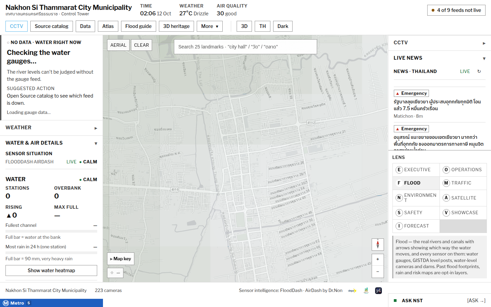
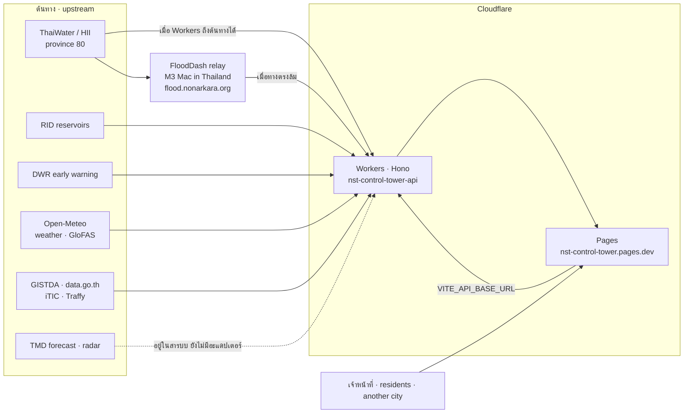
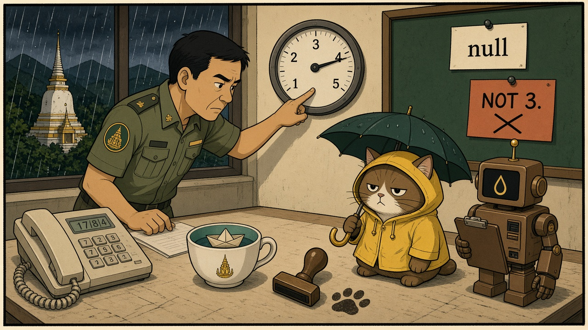

# ศูนย์บัญชาการน้ำท่วม นครศรีธรรมราช
# Nakhon Si Thammarat Flood Control Tower

เทศบาลนครนครศรีธรรมราช · เปิดใช้งานจริงที่ [nst-control-tower.pages.dev](https://nst-control-tower.pages.dev)

ภาษาไทยอยู่ทุกหัวข้อ ก่อนภาษาอังกฤษ · [ฉบับภาษาไทยล้วน](README.th.md)

  

ภาพจากเว็บที่ใช้งานจริง วันที่ 12 ตุลาคม 2569 มุมมอง Flood (ปุ่ม 3) ไม่ใช่ภาพจำลอง

---

## ระบบนี้คืออะไร และใครใช้

### ภาษาไทย

นครศรีธรรมราชตั้งเชิงเขาหลวง สูง 1,835 เมตร น้ำจากเขาลงคลองท่าดี ผ่านเมืองเก่า สู่ลุ่มปากพนัง เวลาฝนตั้งเค้า เจ้าหน้าที่ต้องตอบให้ได้ภายในนาทีว่าน้ำอยู่ตรงไหน และต้องพาใครออกก่อน

นี่คือหอควบคุมของเทศบาลนครสำหรับงานนั้น เปิดให้ดูบนเว็บได้ฟรี โค้ดเป็นสัญญาอนุญาต MIT เทศบาลอื่นโคลนไปปักหมุดเมืองตัวเองได้

ใช้สามกลุ่ม

- **เจ้าหน้าที่เทศบาลและหน่วยเผชิญเหตุ** ดูสถานีวัดน้ำ ฝน อ่างเก็บน้ำ หมู่บ้านที่ต้องเคลื่อนย้ายก่อน และเบอร์ที่ต้องโทร
- **ประชาชน** เปิดดูสถานการณ์น้ำของเมืองได้เอง อ่านป้ายความสดของข้อมูลได้ โดยไม่ต้องรอข่าวสรุป
- **เทศบาลอื่น** ใช้เป็นแบบตั้งเมืองใหม่ ขั้นตอนอยู่ใน [คู่มือแตกกิ่ง](docs/FORK.md)

### English

Nakhon Si Thammarat sits under Khao Luang (1,835 m). Rain on the mountain comes down the Tha Dee, through the old town, and into the Pak Phanang basin. In a rising flood the useful question is short: where is the water, and who has to move first.

This is the city municipality’s control tower for that question. The site is public. The code is MIT. Another municipality can fork it and point it at its own ground.

Three readers:

- **City staff and responders** get river gauges, rain, reservoirs, the villages to move first, and the numbers to call.
- **Residents** can open the same picture and see how old each reading is.
- **Other municipalities** can stand up their own copy. The steps are in the [fork guide](docs/FORK.md).

---

## สิ่งที่ขึ้นบนจอ

### ภาษาไทย

**สถานีวัดระดับน้ำของ สสน. (ThaiWater / HII)** จังหวัดนครศรีธรรมราช รหัสจังหวัด `80` แคชในเซิร์ฟเวอร์ 10 นาที ระดับสถานการณ์เป็นมาตรของ สสน. เอง

| ระดับ | ความหมายในข้อมูล | คำที่ขึ้นบนแถวสถานี |
|---|---|---|
| 1 | แล้งวิกฤต | DROUGHT |
| 2 | น้ำน้อย | LOW |
| 3 | ปกติ | OK |
| 4 | น้ำมาก | HIGH |
| 5 | ล้นตลิ่ง | FLOOD |

เลข 3 คือคำของ สสน. ว่าลำน้ำปกติดี ระบบจะใส่เลขนี้ก็ต่อเมื่อ สสน. ส่งมาจริง

**ฝน** สถานีวัดฝน ThaiWater ของจังหวัด แคช 30 นาที มีฝน 1 ชั่วโมงและ 24 ชั่วโมง สถานีเตือนน้ำหลากของกรมทรัพยากรน้ำ (DWR EWS) แยกต่างหาก แคช 15 นาที

**อ่างเก็บน้ำ** กรมชลประทานสี่แห่งที่โค้ดเลือกไว้: ห้วยน้ำใส (`rsv434`) คลองกะทูน (`rsv435`) บ้านเสม็ดจวน (`rsv436`) คลองดินแดง (`rsv437`) ความจุและปริมาณเก็บมาจาก API สาธารณะ แคช 1 ชั่วโมง คลองท่าดีไม่มีเขื่อนควบคุม ชั้นแผนที่ชื่อ `dam-status` จึงเป็นอัตราการไหลจาก GloFAS ของ Open-Meteo ไม่ใช่ความจุอ่าง และเมื่อต้นทางล่มชั้นนี้จะถูกแปะว่าเป็นสถานการณ์จำลอง

**ศูนย์จัดการภัยและคนที่ต้องย้ายก่อน** ทะเบียนหมู่บ้านเสี่ยงน้ำท่วมของสำนักงานจังหวัด มี 437 หมู่บ้านในไฟล์ที่คอมมิตไว้ 436 แห่งผูกกับศูนย์จัดการภัยพิบัติของท้องถิ่น จากชุดข้อมูล “1 ตำบล 1 ศูนย์จัดการภัยพิบัติที่ผ่านการฝึกอบรม” แผงบอกชื่อหน่วยงานที่ต้องโทร และว่าคนของศูนย์นั้นผ่านการฝึกหรือยัง บันไดการตัดสินใจบอกจังหวะตรวจและเปิดที่พักพิง ระบบไม่ได้รายงานจำนวนคนในศูนย์แบบนาทีต่อนาที และไม่เปิดชื่อที่อยู่ของผู้อยู่อาศัย ชื่อจริงอยู่ที่สถานีอนามัยกับ อสม.

**สายด่วน** ที่ตรวจกับสารบบหน่วยงานแล้ว และใช้ในจังหวัดนี้ได้

| เบอร์ | หน่วยงาน | ใช้เมื่อ |
|---|---|---|
| **1784** | ปภ. | น้ำท่วม กู้ภัย อพยพ |
| **1669** | การแพทย์ฉุกเฉิน | เจ็บป่วย บาดเจ็บ ไฟดูด |
| 199 | ดับเพลิงและกู้ภัย | ไฟไหม้ กู้ภัย |
| 191 | ตำรวจ | เหตุด่วนเหตุร้าย |
| 1129 | กฟภ. | ไฟฟ้าขัดข้อง สายไฟลงน้ำ |

1784 กับ 1669 ขึ้นก่อนเสมอ ถ้าข้อความในช่องสนทนาบ่งว่ามีคนติดอยู่หรือน้ำเข้าบ้าน ระบบจะโชว์เบอร์ก่อนคำตอบอื่น

มุมมองแผนที่มีเก้ามุมใน `LENSES` เปิดมาที่ Operations ปุ่ม `3` คือ Flood

### English

**HII ThaiWater river gauges** for province code `80`, cached 10 minutes. The situation scale is HII’s own:

| Level | Meaning in the type | Label on the gauge row |
|---|---|---|
| 1 | critical drought | DROUGHT |
| 2 | low | LOW |
| 3 | normal | OK |
| 4 | high | HIGH |
| 5 | overbank / flood | FLOOD |

Level 3 is HII’s word for a channel that is fine. It is stored only when HII sent it.

**Rain.** Provincial ThaiWater rain stations, cached 30 minutes, with 1-hour and 24-hour totals. The Department of Water Resources early-warning network (flash flood and soil) is a separate feed, cached 15 minutes.

**Reservoirs.** Four Royal Irrigation Department reservoirs the adapter keeps: Huai Nam Sai (`rsv434`), Khlong Kathun (`rsv435`), Ban Samet Chuan (`rsv436`), Khlong Din Daeng (`rsv437`). Capacity and stored volume come from RID’s public API, cached 1 hour. The Tha Dee has no regulating dam, so the map layer `dam-status` is an Open-Meteo GloFAS discharge proxy with null storage. If that upstream fails, the feed is marked scenario.

**Disaster centres and who moves first.** The committed provincial flood-risk register has 437 villages. 436 of them carry the local disaster-management centre from the “one tambon, one trained disaster centre” dataset, including whether that centre’s people are trained. The decision ladder tells staff when to check and open shelters. The screen does not show live shelter headcount, and it does not publish residents’ names or addresses. Those stay with the health station and the village health volunteers.

**Hotlines** checked against agency directories and valid here:

| Number | Agency | Use |
|---|---|---|
| **1784** | DDPM (ปภ.) | flood, rescue, evacuation |
| **1669** | Emergency medical | illness, injury, electric shock |
| 199 | Fire and rescue | fire, rescue |
| 191 | Police | police emergencies |
| 1129 | PEA | power emergency, live wires in water |

1784 and 1669 lead. A chat message that sounds like someone is trapped or the house is flooding shows the numbers before any reply.

Nine lenses are registered in `LENSES`. The app opens on Operations. Key `3` is Flood.

---

## ความซื่อตรงของข้อมูล

### ภาษาไทย

ตัวเลขบนจอมาจากต้นทางจริง หรือถูกแปะป้ายว่าเป็นแบบจำลอง ข้อมูลอ้างอิง หรือใช้การไม่ได้ หัวแผงทุกอันใช้ `PanelHeader` แสดงแหล่ง อายุ และชั้นข้อมูล

1. **สถานีที่ สสน. ไม่ได้จัดระดับ จะเป็น `null` และถูกบอกไว้** ไม่ถูกใส่เลข 3 และไม่ถูกนับในกลุ่มปกติ แผงสถานีจะขึ้นข้อความว่ากี่สถานีไม่ได้รายงานระดับสถานการณ์ และไม่ถูกนับเป็นปกติ พร้อมชื่อสถานี ระดับน้ำและความสูงจากตลิ่งที่วัดได้ยังอยู่
2. **ข้อมูลเก่ามีป้าย** อายุบนหัวแผงเป็น `LIVE`, นาที, ชั่วโมง หรือวัน สีสดเมื่ออายุต่ำกว่า 5 นาที ระหว่าง 5 ถึง 30 นาทีเป็นสีธรรมดา สีเตือนตั้งแต่ 30 นาที สีเก่าตั้งแต่ 120 นาที ชั้นที่ไม่ใช่สดขึ้นป้าย `CACHE`, `DB`, `SCENARIO`, `REF` หรือ `OFFLINE`
3. **มาตรวัดที่ดับจะพูดเอง** สถานีที่เงียบเกิน 6 ชั่วโมงถูกตัดออกจากรายการ และบันทึกบอกจำนวนที่ตัด ถ้ามาตรวัดแม่น้ำออฟไลน์ทั้งชุด แผง “ใครต้องย้ายก่อน” จะบอกว่ามองไม่เห็นแม่น้ำ หมู่บ้านที่ไม่มีสัญญาณจึงยังไม่ถือว่าปลอดภัย และให้ยืนยันกับ ปภ. 1784 ก่อนปลดใคร

ตัวอย่างที่แก้ใน [`c8c785e`](https://github.com/Nonarkara/nst-control-tower/commit/c8c785ef4873d4527c44d407c84f5848ed8a1473) ฟังก์ชัน `situation()` ทั้งใน `thaiwater.ts` และ `floodDashRelay.ts` เคยอ่าน `Math.round(raw ?? 3)` เลข 3 ไม่ใช่ค่ากลาง มันคือคำว่าปกติของ สสน. วันที่ 12 ตุลาคม 2569 สถานีโรงเรียนวัดโคกโพธิ์สถิตย์ อำเภอลานสกา เป็นหนึ่งใน 23 สถานีที่รายงานขณะนั้นซึ่งไม่มีระดับสถานการณ์ ทางสองทางยังตีความเลข 0 คนละแบบ ทางตรงเคยบีบเป็น 3 ทางรีเลย์เคยบีบเป็น 1 ตอนนี้ค่าที่ไม่อยู่ในช่วง 1–5 เป็น `null` ทั้งคู่ สถานีที่ไม่มีระดับจะไม่ลอยขึ้นหัวรายการ

คอมมิตนั้นบันทึกขอบที่ยังอยู่: ถ้าไม่มีทั้งระดับสถานการณ์ ความจุลำน้ำ และแนวโน้มขาขึ้น แถบสรุปยังลงว่าสงบได้ เพราะชนิด `SituationBand` ยังไม่มีค่า “ไม่ทราบ”

### English

Every figure is a real upstream reading, or it wears a label: scenario, reference, or unavailable. Each panel header shows source, age, and tier.

1. **A station HII did not classify stays `null`, and the panel says so.** It is not filled with 3, and it is not filed under the normal rows. The gauge list names those stations. Level and freeboard that were actually measured stay on the row.
2. **Stale data is labelled.** The header prints `LIVE`, minutes, hours, or days. Under 5 minutes is fresh, 5 to 30 minutes stays neutral, from 30 minutes is a warning, and from 120 minutes is stale. Anything other than live also gets `CACHE`, `DB`, `SCENARIO`, `REF`, or `OFFLINE`.
3. **A dead gauge says so.** A station silent for more than 6 hours is dropped, and the note counts the drops. When the river gauges are offline as a set, the “who to move first” panel says the rivers cannot be seen, so a village with no signal is not known to be safe, and tells the operator to confirm with ปภ. 1784 before standing anyone down.

The repair is [`c8c785e`](https://github.com/Nonarkara/nst-control-tower/commit/c8c785ef4873d4527c44d407c84f5848ed8a1473). `situation()` in both `thaiwater.ts` and `floodDashRelay.ts` used `Math.round(raw ?? 3)`. Three is HII’s word for normal. On 12 October 2026, Wat Khok Pho Sathit School in Lan Saka was one of 23 reporting stations with no situation level. The two adapters also disagreed on an out-of-range 0: the direct path clamped it to 3, the relay to 1. Out of the 1–5 scale is now `null` on both paths, and an unclassified station cannot sort to the top by default.

That commit left one edge on the record: a station with no level, no fullness, and no rising trend can still band as calm, because `SituationBand` has no “unknown” member.

---

## สถาปัตยกรรม

### ภาษาไทย

เว็บอยู่บน Cloudflare Pages ตัว API เป็น Hono บน Cloudflare Workers แคชอยู่ในหน่วยความจำของ isolate บล็อก KV ใน `wrangler.toml` ถูกคอมเมนต์ไว้ ThaiWater ตอบไอพีในไทย แต่บางช่วงไม่ตอบขาออกของ Cloudflare เมื่อทางตรงล้ม มาตรวัดน้ำและฝนจะมาทาง FloodDash ที่ `flood.nonarkara.org` ซึ่งไปดึง สสน. จากแมคในประเทศไทย เครื่องนั้นเป็น Apple M3 กรมอุตุนิยมวิทยาอยู่ในสารบบแล้ว ยังไม่มีอะแดปเตอร์: พยากรณ์ 3 ชั่วโมงอยู่สถานะ `planned` และเรดาร์อยู่สถานะ `research`

### English

The web app is Cloudflare Pages. The API is Hono on Cloudflare Workers. The cache is memory inside the isolate. The KV binding in `wrangler.toml` is commented out. ThaiWater answers a Thai IP and sometimes refuses Cloudflare’s egress. When the direct call fails, water and rain come through FloodDash at `flood.nonarkara.org`, which polls HII from a Mac in Thailand. That machine is an Apple M3. TMD is in the catalog and not yet an adapter: the 3-hour forecast is `planned`, the radar is `research`.

โมโนรีโปมีสามส่วน: `apps/web` (React 19, Vite, deck.gl, MapLibre), `apps/api` (Hono), `packages/shared` (ชนิดข้อมูลและสารบบแหล่ง) ทุกเส้นทางที่เป็นฟีดคืน `NormalizedFeed<T>` คือ `features` กับ `meta` (`source`, `fetchedAt`, `ageMinutes`, `fallbackTier`) อะแดปเตอร์ที่ดึงไม่สำเร็จต้องโยนข้อผิดพลาด แคชจึงส่งค่าดีล่าสุดได้ แทนรายการว่างที่อ่านเหมือน “ไม่มีอะไรเกิดขึ้น” รายละเอียดอยู่ใน [`docs/ARCHITECTURE.md`](docs/ARCHITECTURE.md)

---

## แหล่งข้อมูล อัตราดึง และเงื่อนไขที่โค้ดเขียนไว้

ตัวเลขนาทีข้างล่างคือ TTL ของแคชในอะแดปเตอร์ ซึ่งเป็นตัวกันไม่ให้ดึงต้นทางทุกครั้งที่มีคนเปิดหน้า คอลัมน์การเข้าถึงยกคำที่ไฟล์นั้นเขียนไว้ สารบบ `pollSeconds` ใน `packages/shared/src/sources.ts` เก่ากว่าแคชจริงในบางแถว: อากาศ Open-Meteo ในสารบบ 30 นาที แต่แคช 3 ชั่วโมง, ตาราง WRF ในสารบบ 30 นาที แต่แคช 6 ชั่วโมง, ตลาดในสารบบ 10 นาที แต่แคช 30 นาที, UNOSAT ในสารบบ 7 วัน แต่แคช 30 วัน รีโปนี้ไม่ได้เก็บฟิลด์สัญญาอนุญาตกลาง สิทธิในข้อมูลเป็นของหน่วยงานเจ้าของ

The minutes below are the adapter cache TTL, the value that actually stops a refetch. The access column quotes what that file says. `pollSeconds` in `packages/shared/src/sources.ts` is older than the cache on a few rows: Open-Meteo weather is 30 minutes in the catalog and 3 hours in the adapter, WRF 30 minutes versus 6 hours, markets 10 minutes versus 30 minutes, UNOSAT 7 days versus 30 days. This repo has no single licence field. The data stays with the agency that published it.

| แหล่ง | เส้นทาง | แคช | การเข้าถึงตามที่โค้ดเขียน |
|---|---|---|---|
| สถานีวัดน้ำ สสน. | `/api/water/gauges` | 10 นาที | ไม่ต้องยืนยันตัวตนบน `/public/` ล้มแล้วไปรีเลย์ FloodDash |
| ฝน สสน. | `/api/water/rain` | 30 นาที | เช่นเดียวกัน |
| DWR EWS | `/api/water/ews` | 15 นาที | ไม่ต้องยืนยันตัวตน |
| อ่าง RID | `/api/water/reservoirs-rid` | 1 ชั่วโมง | API สาธารณะ ไม่ต้องล็อกอิน |
| ดุลน้ำรายลุ่ม | `/api/water/balance` | 10 นาที | แบบจำลอง ป้าย MODELLED ระดับ สสน. ยังเป็นคำเตือนทางการ |
| คะแนนเฝ้าระวังภาคใต้ | `/api/flood/south/risk` | 5 นาที | ฮิวริสติก ไม่ใช่คำพยากรณ์ |
| ลำน้ำ GloFAS ภาคใต้ | `/api/flood/south/rivers` | 3 ชั่วโมง | Open-Meteo Flood ไม่ใช้คีย์ |
| อัตราไหลท่าดี / ชั้น dam-status | อะแดปเตอร์ `flood.ts` | 3 ชั่วโมง | API น้ำท่วมฟรี ของจำลองเมื่อต้นทางล่ม ความจุเป็น null |
| ฝน WRF-ROMS ของ สสน. | อะแดปเตอร์ `wrfRain.ts` | 6 ชั่วโมง | ฟรี ไม่ใช้คีย์ |
| ภาพน้ำท่วม GISTDA พ.ย. 2568 | `/api/gistda/flood-extent` | 24 ชั่วโมง | FeatureServer ไม่ใช้โทเคน ข้อมูลอ้างอิงคงที่ |
| สถานีระดับน้ำ GISTDA | `/api/gistda/flood-stations` | 6 ชั่วโมง | สแนปช็อต ชั้น `database` ไม่ใช้แทน สสน. |
| เสาระดับ GISTDA | `/api/gistda/level-posts` | 24 ชั่วโมง | ข้อมูลอ้างอิงคงที่ |
| อากาศ Open-Meteo | `/api/weather` | 3 ชั่วโมง | ไม่ใช้คีย์ คอมเมนต์ในโค้ดว่าถนอมโควตารายวัน |
| คุณภาพอากาศกริด | `/api/air-quality` | 1 ชั่วโมง | ฟรี ไม่ใช้คีย์ ตามสารบบ |
| Air4Thai | `/api/air-quality/air4thai` | 30 นาที | สาธารณะ ไม่ใช้คีย์ |
| พยากรณ์ฝนระยะสั้น | อะแดปเตอร์ `precipNowcast.ts` | 30 นาที | ฟรี ไม่ใช้คีย์ |
| ฝนย้อนหลัง | อะแดปเตอร์ `historicalRain.ts` | 24 ชั่วโมง | Open-Meteo Archive ไม่ใช้คีย์ |
| เหตุการณ์ iTIC / Longdo | `/api/incidents/itic` | 3 นาที | ฟีดสาธารณะ |
| เรื่องร้องเรียน Traffy | `/api/incidents/city-reports` | 5 นาที | ฟีดสาธารณะ กรองขอบเขตเมือง |
| ข่าว | `/api/news` | 3 นาที | RSS |
| แนวโน้มค้นหา | อะแดปเตอร์ `trends.ts` | 15 นาที | แคชเพื่ออยู่ใต้ลิมิตของกูเกิล |
| ตลาด FMP / FRED | `/api/markets` | 30 นาที | ต้องมีคีย์ ไฟล์ตัวอย่างระบุชั้นฟรี 250 ครั้ง/วัน และ 120,000 ครั้ง/วัน |
| เที่ยวบินสนามบิน | อะแดปเตอร์ `flights.ts` | 90 นาที | ต้องมีคีย์ แคชนี้ตั้งไว้ให้อยู่ในชั้นฟรี 1,000 ครั้ง/เดือน |
| ทางน้ำ OSM | อะแดปเตอร์ `waterways.ts` | 7 วัน | Overpass เฉพาะกล่องจังหวัด |
| พื้นที่เสี่ยงน้ำท่วม | อะแดปเตอร์ `floodProne.ts` | 24 ชั่วโมง | ชุดข้อมูลคงที่ |
| UNOSAT 2564 | อะแดปเตอร์ `unosatExposure.ts` | 30 วัน | ข้อมูลอ้างอิง |
| NASA POWER | อะแดปเตอร์ `nasa-power.ts` | 6 ชั่วโมง | ฟรี ไม่ใช้คีย์ ตามสารบบ |
| แผ่นภาพ NASA GIBS | เบราว์เซอร์ดึงแผ่นเอง | ไม่มีโพลล์ฝั่งเซิร์ฟเวอร์ | ฟรี ไม่ใช้คีย์ ตามสารบบ |
| AQICN | `/api/air-quality/aqicn` | 15 นาที | ต้องมี `AQICN_TOKEN` ไม่มีคีย์แล้วเป็นชั้น `unavailable` พร้อม note |
| Facebook เทศบาล | `/api/social/facebook` | 10 นาที | โทเคนหรือ iframe ของเพจ |

สารบบทั้งก้อนมี 77 รายการ: สด 33, พร้อมต่อ 10, วางแผน 17, ยังค้นแหล่ง 17 นับจาก `status` ใน `packages/shared/src/sources.ts` รายการที่ยังไม่สด รวมพยากรณ์และเรดาร์ของกรมอุตุนิยมวิทยา จะไม่ถูกนับเป็นฟีดที่ใช้งาน

---

## แตกกิ่งไปใช้กับเมืองคุณ

### ภาษาไทย

เลือกกรอบแผนที่ ตั้งแหล่งข้อมูล แล้วขึ้น Cloudflare โดยมีเบรกค่าใช้จ่ายที่โค้ดใส่ว่าไว้แล้ว รายการตรวจอยู่ท้ายคู่มือ

คู่มือเต็มสองภาษา: [`docs/FORK.md`](docs/FORK.md)

### English

Pick the map frame, point the sources, and deploy to Cloudflare with the cost brakes the code already has. The checklist is at the end of the guide.

Full guide, both languages: [`docs/FORK.md`](docs/FORK.md)

---

## ร่วมพัฒนา ความปลอดภัย เครดิต

- การส่งแพตช์ การทดสอบ และสัญญาของอะแดปเตอร์: [`CONTRIBUTING.md`](CONTRIBUTING.md)
- การรายงานช่องโหว่ และสิ่งที่ห้ามใส่ในกิต: [`SECURITY.md`](SECURITY.md)
- สัญญาอนุญาตโค้ด: [MIT](LICENSE) © 2026 Non Arkaraprasertkul
- ข้อมูลเป็นของหน่วยงานเจ้าของ: สสน. (ThaiWater), กรมชลประทาน, กรมทรัพยากรน้ำ, GISTDA, data.go.th และสำนักงานจังหวัด, ปภ., iTIC/Longdo, Traffy Fondue (NECTEC), Open-Meteo, นาซา, OpenStreetMap, UNOSAT/UNITAR
- รีเลย์มาตรวัดคือ [FloodDash](https://flood.nonarkara.org) ตัวเลขยังเป็นของ สสน. โค้ดของที่นี่เขียนไว้ว่า FloodDash ทำหน้าที่ส่งต่อ
- เว็บที่ใช้งาน: [nst-control-tower.pages.dev](https://nst-control-tower.pages.dev) · API: `nst-control-tower-api.drnon.workers.dev`
- โค้ดยังพาโฮสต์เก่าของชลบุรี ยะลา และจุฬาฯ กลับเข้าเวิร์กเกอร์นี้ (`apps/web/src/lib/apiBase.ts`) ชื่อภูเก็ตไม่ปรากฏในรีโป

---

  

